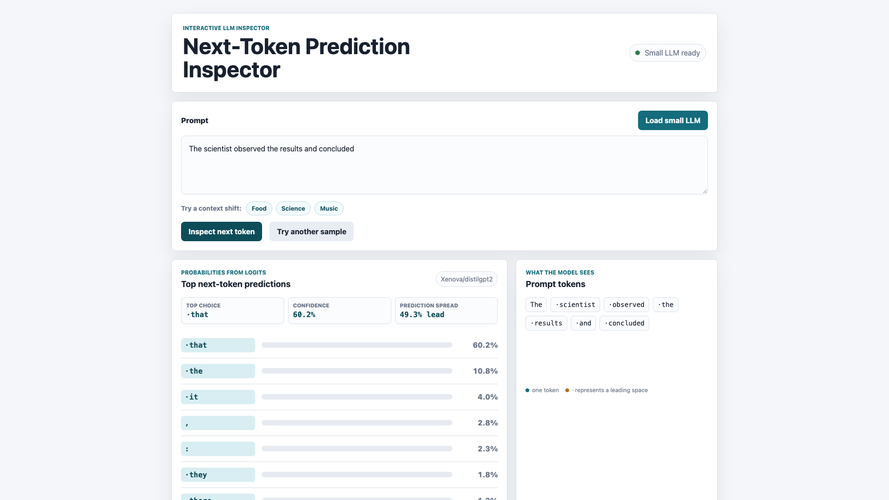

# Next-Token Prediction Inspector

Next-Token Prediction Inspector is a static browser app that uses the real `Xenova/distilgpt2` model through Transformers.js to show how prompt context changes the probabilities of the next token. Enter a prompt, inspect its tokenization and top eight predictions, then compare food, science, and music context presets. It runs entirely in the browser with no build step.

